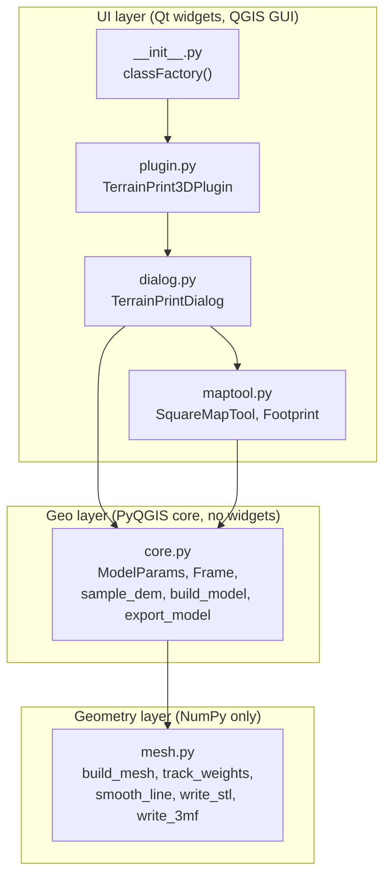
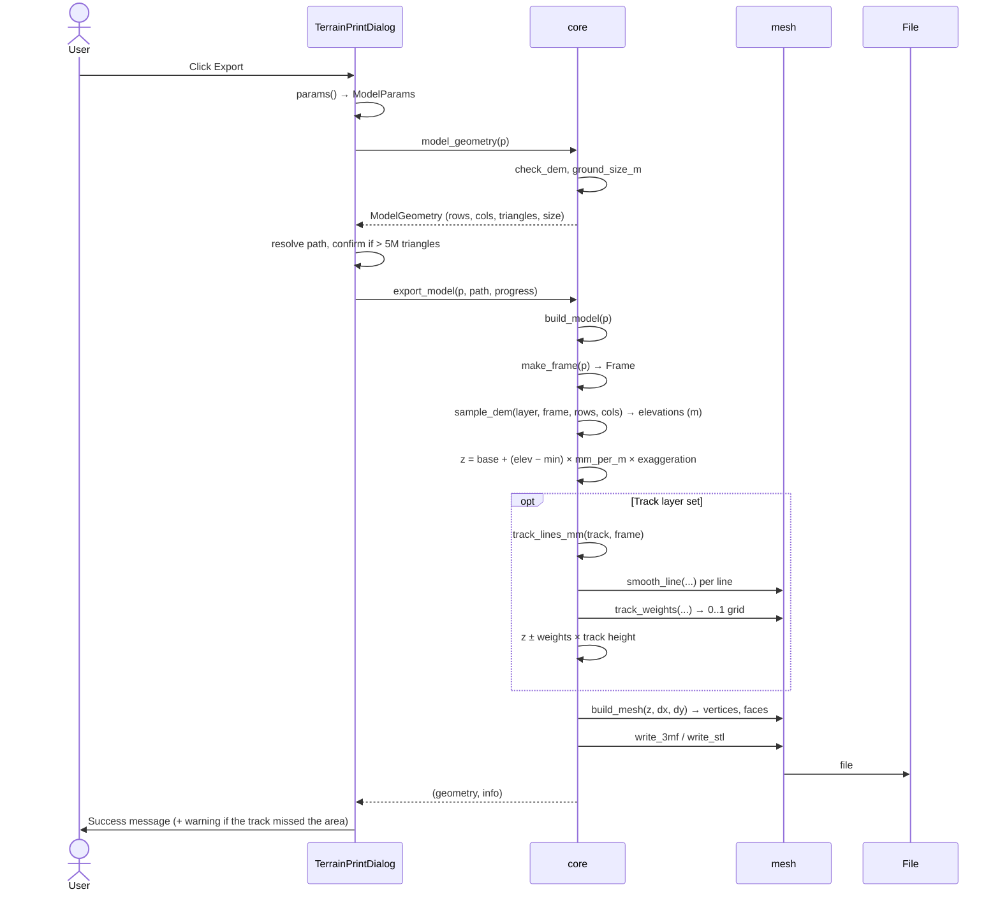
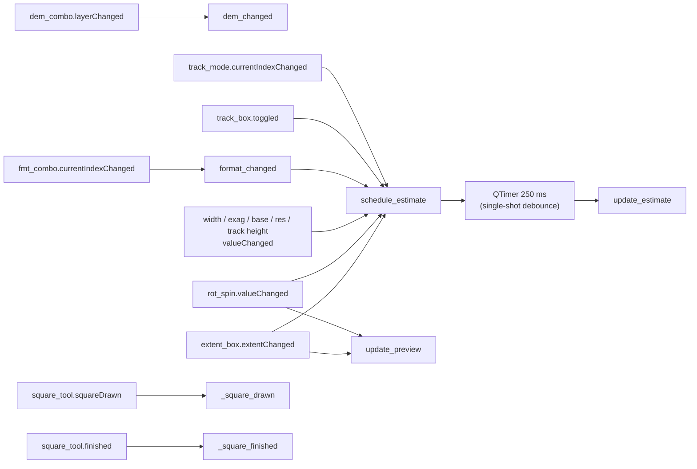

# TerrainPrint3D: Technical Documentation

This document explains how the TerrainPrint3D plugin works internally: its modules, every function and class, how data flows from a DEM layer to a printable file, and the maths and design decisions behind each step.

For installation and everyday use, see the [README](../README.md).

---

## Contents

1. [Overview](#1-overview)
2. [Architecture](#2-architecture)
3. [The export pipeline, end to end](#3-the-export-pipeline-end-to-end)
4. [Coordinate systems and units](#4-coordinate-systems-and-units)
5. [Module reference](#5-module-reference)
   - [`__init__.py`](#51-__init__py)
   - [`plugin.py`](#52-pluginpy)
   - [`dialog.py`](#53-dialogpy)
   - [`maptool.py`](#54-maptoolpy)
   - [`core.py`](#55-corepy)
   - [`mesh.py`](#56-meshpy)
6. [Algorithms in depth](#6-algorithms-in-depth)
7. [Parameters reference](#7-parameters-reference)
8. [Error handling and warnings](#8-error-handling-and-warnings)
9. [Testing](#9-testing)
10. [Compatibility notes](#10-compatibility-notes)
11. [Known limitations and possible improvements](#11-known-limitations-and-possible-improvements)

---

## 1. Overview

TerrainPrint3D turns part of a digital elevation model (DEM) loaded in QGIS into a **closed (watertight), outward-facing triangle mesh** that a slicer can print directly. The output is a 3MF or binary STL file.

Main capabilities:

| Capability | Where it lives |
|---|---|
| Pick a DEM layer and an area (extent box, or draw a square on the map) | `dialog.py`, `maptool.py` |
| Rotate the area so any compass direction is at the model's top edge | `core.Frame`, `maptool.SquareMapTool` |
| True-scale sizing in any CRS (metres, feet, degrees, Web Mercator) | `core.ground_size_m`, `core.square_extent` |
| Live estimate of scale, size, height, triangle count and file size | `dialog.update_estimate`, `core.model_geometry`, `mesh.estimate_file_bytes` |
| Accurate DEM sampling with NoData handling and bounded memory | `core.sample_dem`, `core._read_decimated` |
| GPX or line-layer tracks, raised or engraved, smoothed and anti-aliased | `core.track_lines_mm`, `mesh.smooth_line`, `mesh.track_weights` |
| Closed mesh generation | `mesh.build_mesh` |
| STL and 3MF writers with no extra dependencies | `mesh.write_stl`, `mesh.write_3mf` |

**Dependencies:** QGIS ≥ 3.22 (PyQGIS and Qt) and NumPy, which ships with QGIS. There are no other third-party packages.

---

## 2. Architecture

The code is organised in **three layers**. Each layer only depends on the layers below it:



| Layer | Module(s) | Imports | Why it's separated |
|---|---|---|---|
| UI | `plugin.py`, `dialog.py`, `maptool.py` | Qt widgets, `qgis.gui` | All user interaction and canvas drawing |
| Geo | `core.py` | `qgis.core`, NumPy | CRS handling, DEM reading and model assembly. Has no widgets, so it runs headless in `tests/test_core.py`. |
| Geometry | `mesh.py` | NumPy, stdlib only | Pure maths and file writing. Testable with plain Python (`tests/test_mesh.py`). |

The interface between the UI and the logic is a single **`core.ModelParams`** dataclass. The dialog fills it in from its widgets, and everything in `core` reads from it.

---

## 3. The export pipeline, end to end

What happens when the user clicks **Export**:



Progress is reported through a `progress(pct, msg)` callback at 5 % (reading the DEM), 35 % (adding the track), 55 % (building the mesh), 75 % (writing the file) and 100 %.

### Step by step

1. **Collect parameters.** `TerrainPrintDialog.params()` builds a `ModelParams` from the widgets. It raises `ValueError` if no DEM is selected, or if the track option is on but no track layer is chosen.
2. **Validate and size.** `core.model_geometry(p)` checks that the layer really holds elevations (`check_dem`), measures the extent on the ellipsoid (`ground_size_m`), and works out the model's depth, the grid size (`rows × cols`), the scale, and the predicted triangle count and file size.
3. **Build a frame.** `core.make_frame(p)` creates a `Frame`, the two-way mapping between model millimetres and DEM CRS coordinates, including rotation.
4. **Sample elevations.** `core.sample_dem` returns an elevation, in metres, for every grid node.
5. **Convert to model heights.**
   `z_mm = base_mm + (elev − elev_min) × mm_per_m × exaggeration`.
   The lowest point therefore sits exactly at the base thickness.
6. **Apply the track (optional).** The track lines are reprojected to model mm, optionally smoothed, and rasterised into a 0..1 weight grid. The weights are added to `z` (raise) or subtracted from it (engrave). When engraving, `z` is clamped to at least `base_mm × 0.5` so the model never punches through its bottom.
7. **Mesh.** `mesh.build_mesh(z, dx, dy)` builds the top surface, the four side walls and the bottom.
8. **Write.** `mesh.write_3mf` or `mesh.write_stl`.
9. **Report.** The dialog shows the file size, triangle count and height. If a track was enabled but no grid node was touched by it (`track_cells == 0`), it warns that the track doesn't cross the area.

---

## 4. Coordinate systems and units

Four coordinate spaces are involved. Keeping them straight is the key to understanding the code.

| Space | Units | Origin / orientation | Used by |
|---|---|---|---|
| **Canvas CRS** | Whatever the map uses | QGIS map canvas | Mouse events in `SquareMapTool` |
| **DEM CRS** | DEM layer's units (m, ft, °) | Layer's own CRS | `ModelParams.extent`, `Frame.to_crs`, raster reads |
| **Local metres** | metres | Centre of the extent; east/north axes | Inside `Frame` (`e`, `n`) |
| **Model mm** | millimetres | Bottom-left corner of the model = (0, 0); x to the right, y toward the top edge, z up from the print bed | `mesh.py`, track lines, output files |

### Grid convention (`mesh.py`)

The height grid `z` has shape `(rows, cols)`. **Row 0 is the model's top edge** ("north" when the rotation is 0°). Node `(r, c)` sits at

```
x = c × dx
y = (rows − 1 − r) × dy
```

and the model's bottom face is at `z = 0`.

### Rotation convention

`rotation_deg` is the **compass bearing of the model's top edge**, measured clockwise from north. At 0° north is at the top; at 90° east is at the top; at −90° west is at the top. The extent stored in `ModelParams.extent` is the area *before* rotation; the rotation turns it around its centre. That's why the dialog renames the extent box to "Extent (before rotation)" when the rotation isn't zero.

---

## 5. Module reference

### 5.1 `__init__.py`

| Function | Purpose |
|---|---|
| `classFactory(iface)` | QGIS entry point. Imports and returns `TerrainPrint3DPlugin(iface)`. The import is deferred so QGIS can scan the plugin cheaply. |

`metadata.txt` declares the plugin to QGIS: name, version 0.1.0, minimum QGIS 3.22, category *Raster*, `experimental=True`.

---

### 5.2 `plugin.py`

**`class TerrainPrint3DPlugin`**: the QGIS plugin object. It owns one menu/toolbar action and at most one dialog.

| Method | What it does |
|---|---|
| `__init__(iface)` | Stores `iface`; the action and dialog start as `None`. |
| `initGui()` | Creates the `QAction` with `icon.svg` and adds it to the **Raster toolbar** and the **Raster → TerrainPrint3D** menu. |
| `unload()` | Removes the toolbar icon and menu entry. If a dialog exists, calls `dialog.cleanup()` (removes rubber bands from the canvas), then `deleteLater()`. |
| `run()` | Lazily imports `dialog.py`, creates the dialog the first time (it is **reused** after that, so settings persist during a session), then shows, raises and focuses it. |

---

### 5.3 `dialog.py`

The plugin window. It is **non-modal**: the user can keep using QGIS while it's open.

#### Module-level helpers

| Name | Purpose |
|---|---|
| `RASTER_FILTER`, `LINE_FILTER` | Layer-combo filters. Uses `Qgis.LayerFilter` on QGIS ≥ 3.34 and falls back to `QgsMapLayerProxyModel` on older versions. |
| `BIG_TRIANGLES = 5_000_000` | Threshold for the "large model" warning and confirmation. |
| `_human(n)` | Formats a byte count as `B`, `KB`, `MB` or `GB`. |
| `_spin(lo, hi, val, step, suffix, decimals)` | Factory for a configured `QDoubleSpinBox`. |

#### `class TerrainPrintDialog(QDialog)`

**Widgets, top to bottom**

| Section | Widgets | Defaults |
|---|---|---|
| DEM | `dem_combo` (raster layers only) | Current layer |
| Extent | `extent_box` (`QgsExtentGroupBox`, linked to the canvas) | Canvas extent when shown |
| Square/rotation | `square_btn` "Draw square on map…", `rot_spin` (−180…180°, wrapping) | 0° |
| Model | `width_spin` (10–2000 mm), `exag_spin` (0.1–50×), `base_spin` (0.4–100 mm), `res_spin` (0.05–10 mm), `fmt_combo` (3MF/STL) | 150 mm, 1.5×, 3 mm, 0.4 mm, 3MF |
| GPX track (checkable group) | `track_combo` (line layers), "Load GPX…", `track_mode` (raise/engrave), `track_h_spin`, `track_w_spin`, `track_smooth_spin` (0 = "Off") | Unchecked; raise, 1.0 mm, 1.2 mm, 1.0 mm |
| Info | `info` rich-text label with the live estimate | – |
| Output | `file_widget` (save path), `progress` bar, **Export** / **Close** buttons | `~/Documents/<layer name>.<fmt>` |

It also owns a `SquareMapTool` (`square_tool`) and a `Footprint` (`preview`), the red outline of the printed area on the map.

**Signal wiring**



`schedule_estimate` restarts a 250 ms single-shot timer, so rapid spin-box changes cause only one recalculation.

**Methods**

| Method | What it does |
|---|---|
| `showEvent` | Each time the dialog appears, it sets the extent box to the current canvas extent and redraws the preview. |
| `closeEvent` | Clears the preview outline and deactivates the square tool if it's active. |
| `cleanup()` | Used on plugin unload: closes the dialog and removes the rubber bands from the canvas scene. |
| `dem_crs()` | CRS of the selected DEM, or the canvas CRS if no DEM is selected. Passed to `SquareMapTool` as a callable so it always uses the current DEM. |
| `start_square()` | Remembers the active map tool, activates `square_tool` and **hides the dialog** so the map is free to draw on. |
| `_square_drawn((center, side_m, rotation))` | Sets the rotation spin box (with its signals blocked, to avoid a double update), converts the square to a DEM-CRS extent with `core.square_extent`, then updates the preview and estimate. |
| `_square_finished()` | Runs when the tool deactivates (finished, cancelled or replaced). On the next event-loop tick it restores the previous map tool, if nothing else took over, and shows the dialog again. |
| `current_frame()` | Builds a `core.Frame` from the current widgets, or `None` if that isn't possible yet. Used only for the preview. |
| `update_preview()` | Updates the extent box title ("before rotation" when rotated) and redraws the footprint. |
| `schedule_estimate()` | Restarts the debounce timer. |
| `fmt()` | `"3mf"` or `"stl"`. |
| `format_changed()` | Updates the file filter and swaps the extension of the current path (only if it was `.stl` or `.3mf`). |
| `_set_path(path, auto)` / `_path_edited()` | Track whether the save path is still **auto-generated**. As long as it is, choosing a different DEM renames the output file to match. Once the user edits the path, it's left alone. |
| `dem_changed(layer)` | Sets the extent box's "original" extent and output CRS to the layer's. Resets the extent to the full layer if the current one is empty or doesn't overlap the layer. Updates the auto path and the estimate. |
| `load_gpx()` | File dialog for `.gpx`. Tries the OGR sublayer `tracks`, then `routes`, and uses the first one that is valid and non-empty: adds it to the project, selects it, and ticks the GPX group. Otherwise it warns. |
| `params()` | Builds `core.ModelParams` from the widgets. This is the **only** place the UI hands data to the core. |
| `_relief(p)` | Cached `core.relief_range(p)`, keyed by (layer id, extent string, rotation). This avoids re-sampling the DEM when only the width, exaggeration or other model settings change. |
| `update_estimate()` | Computes `core.model_geometry` and fills the info label (details below). If it raises, the error is shown in italics and **Export** is disabled. |
| `export()` | Validates the input, resolves the path (asks if empty, adds the extension if missing), asks for confirmation above 5 M triangles, then runs `core.export_model` with a progress callback. Shows a success message in the QGIS message bar, or a critical dialog with the traceback if it fails. |

**What the info label shows** (`update_estimate`)

- **Area** on the ground, in km, and **Scale** `1:N`.
- **Model** footprint in mm, with "(square)" if the ground sides are within 0.2 % of each other, and the estimated **height**: `base + relief × mm_per_m × exaggeration` (+ track height when raising), plus the elevation range.
- A red warning if the rotated area's bounding box isn't fully inside the DEM's extent (`core.inside_dem`).
- **File**: triangle count and size (prefixed with `~` for 3MF because it's an estimate), shown in red above 5 M triangles.

---

### 5.4 `maptool.py`

#### Constants

`POLYGON` / `LINE` geometry types (with a fallback for QGIS < 3.30), `MIN_DRAG_PX = 5`, and `RED = QColor(232, 70, 60)`.

#### `class Footprint`

Draws the printed area on the canvas as two `QgsRubberBand`s: a translucent red polygon and a thicker line (the **up marker**) from the centre to just past the middle of the top edge.

| Method | What it does |
|---|---|
| `show(frame)` | Draws `frame.polygon()`, densified to 32 vertices per edge so it bends correctly when the canvas CRS differs from the DEM CRS, plus `frame.up_marker()`. With `None`, it clears both. |
| `clear()` | Empties both rubber bands (they stay on the canvas). |
| `remove()` | Removes both from the canvas scene entirely. |

#### `class SquareMapTool(QgsMapTool)`

Interaction: **press at the centre → drag → release**.

- **Plain drag:** the square is north-up. The cursor lies on its edge, so the half-side is `max(|Δeast|, |Δnorth|)`.
- **Shift-drag:** the square rotates to follow the cursor. The cursor marks the middle of the model's top edge, so the half-side is the distance to the cursor and the rotation is `atan2(Δeast, Δnorth)`, rounded to 0.1°.
- **Esc or right-click** cancels. A click that moves less than 5 px also cancels and changes nothing.

Signals: `squareDrawn(object)` emits `(centre in DEM CRS, side in metres, rotation in degrees)`; `finished()` fires on every deactivation.

| Method | What it does |
|---|---|
| `square_for(center, cursor, rotate)` | Transforms both points from canvas CRS to DEM CRS. To get local metres per CRS unit, it builds a 1 km probe square with `core.square_extent` and divides by its size, so it works in degrees, feet or metres alike. Returns `(c, side_m, rot)`, or `None` if the transform fails or the size is zero. |
| `frame_for(square)` | Builds a `core.Frame` for the live preview (the 100 mm width is arbitrary; only the shape matters). |
| `canvasPressEvent` | Right button → cancel. Left button → remember the centre and pixel position, and create a `Footprint`. |
| `canvasMoveEvent` | Recomputes the square, draws it, and shows a tooltip with the size in km and either the angle or the hint "(Shift: rotate)". |
| `canvasReleaseEvent` | Computes the final square, clears the rubber band, emits `squareDrawn` if the drag was long enough, and deactivates itself. |
| `keyPressEvent` | Esc → `cancel()`. |
| `cancel()` | Clears everything and deactivates without emitting. |
| `deactivate()` | Clears the drawing, hides the tooltip and emits `finished` (the dialog relies on this to reappear). |

---

### 5.5 `core.py`

Everything that needs QGIS but not widgets.

#### Data classes

**`ModelParams`**: the complete export request. See [§7](#7-parameters-reference) for every field.

**`ModelGeometry`**: derived sizes, returned by `model_geometry`:

| Field | Meaning |
|---|---|
| `ground_w_m`, `ground_h_m` | Real-world width and height of the extent, in metres |
| `width_mm`, `depth_mm` | Model footprint. The depth follows from the ground aspect ratio. |
| `rows`, `cols` | Height-grid size |
| `scale` | The `N` in `1:N` |
| `mm_per_m` | Model millimetres per ground metre (horizontal) |
| `triangles` | Exact triangle count of the final mesh |
| `file_bytes` | Exact (STL) or estimated (3MF) file size |

#### Measuring and sizing

| Function | What it does |
|---|---|
| `distance_area(crs)` | A `QgsDistanceArea` on the CRS's ellipsoid (WGS84 as a fallback). Results are in metres. |
| `ground_size_m(extent, crs)` | Measures the width along the extent's horizontal centre line and the height along its vertical centre line, on the ellipsoid. |
| `square_extent(center, side_m, crs)` | Returns a rectangle in `crs` that measures `side_m × side_m` on the ground. It starts from a guess (metres, or degrees using 111 320 m/° with a cos(latitude) correction) and refines the half-spans up to 6 times until both sides are within 1 ppm. Measuring the same way as `ground_size_m` is what makes the model come out exactly square. |
| `check_dem(layer, band)` | Rejects ARGB colour images (data types 12/13: basemaps, WMS, hillshades) with a friendly message, and rejects any data type not in `_DTYPES`. |
| `model_geometry(p)` | Validates the DEM and extent, measures the ground, and derives `depth_mm`, `cols = round(width/resolution) + 1`, `rows = round(depth/resolution) + 1` (each at least 2), the scale, the triangle count and the file size. **Cheap: it doesn't read any pixels.** That's why the dialog can call it on every change. |

#### `class Frame`: model mm ↔ DEM CRS

This is the geometric core of the plugin. See [§6.1](#61-the-frame-transform) for the maths.

| Member | What it does |
|---|---|
| `__init__(extent, crs, width_mm, rotation_deg)` | Stores the centre, the metres-per-CRS-unit scales `sx` and `sy` (measured on the ellipsoid), the model width `W` and depth `D`, `mm_per_m`, and the cos/sin of the rotation. |
| `to_crs(x_mm, y_mm)` | Model mm → DEM CRS (vectorised; accepts NumPy arrays). |
| `to_model(X, Y)` | DEM CRS → model mm (the exact inverse). |
| `grid(rows, cols)` | DEM-CRS coordinates of every grid node, with row 0 at the top edge. These are the points where elevations are sampled. |
| `corners()` | The four model corners in DEM CRS (bottom-left, bottom-right, top-right, top-left). |
| `bbox()` | Axis-aligned bounding box of the rotated area, used for the "outside the DEM" check. |
| `polygon()` | The rotated area as a `QgsGeometry` polygon (for the footprint). |
| `up_marker()` | Line from the centre to 8 % of the shorter side past the top edge (the "up" arrow on the map). |

`make_frame(p)` is a convenience wrapper: `Frame(p.extent, p.dem_layer.crs(), p.width_mm, p.rotation_deg)`.

`inside_dem(p)` returns `True` if the rotated area's bounding box lies within the DEM's extent. It allows a tolerance of 1e-6 of a pixel, because `Frame.bbox()` recomputes the corners in floating point: an extent equal to the DEM's can come out about 1e-14 units larger and would otherwise fail a strict `contains()` test. The dialog uses it for the "outside the DEM" warning.

#### DEM sampling

| Function | What it does |
|---|---|
| `sample_dem(layer, frame, rows, cols, band)` | Returns an elevation array of shape `(rows, cols)`. See [§6.2](#62-dem-sampling). |
| `_read_decimated(provider, band, bx0, bx1, by1, nat_y, kx, ky, cols, rows, max_pixels=16M)` | Reads a grid-aligned window at **native** resolution in horizontal strips of at most ~16 M pixels, keeping the centre pixel of each `kx × ky` group. Returns the values and a NoData mask. |
| `_odd_factor(ratio)` | The largest odd integer ≤ `ratio`, at least 1. An odd factor means each group has a true centre pixel. |
| `_bilinear_at(src, fx, fy)` | Vectorised bilinear interpolation at fractional pixel coordinates (pixel centres at integer positions), clamped to the array's edges. |
| `_DTYPES` | GDAL/QGIS data type code → NumPy dtype (uint8 … float64, int8). |
| `_block_to_array(block, rows, cols)` | Converts a `QgsRasterBlock` to `(float64 array, nodata mask)`. Uses `block.as_numpy(use_masking=True)` on QGIS ≥ 3.34; otherwise decodes the raw bytes with `_DTYPES` and compares against `noDataValue()`. |
| `relief_range(p)` | Min/max elevation from a coarse 64 × 64 sample, for the dialog's height estimate. Returns `None` on any error. |

#### Tracks

| Function | What it does |
|---|---|
| `track_lines_mm(track_layer, frame)` | Reprojects every feature to the DEM CRS, splits multi-part geometries, and converts each part's vertices to model mm with `frame.to_model`. Returns a list of `(N, 2)` arrays. Points outside the model are kept; rasterisation clips them naturally. |

#### Assembly and export

| Function | What it does |
|---|---|
| `build_model(p, progress=None)` | Runs the pipeline from [§3](#3-the-export-pipeline-end-to-end) and returns `(vertices, faces, ModelGeometry, info)`, where `info` holds `elev_min`, `elev_max`, `height_mm` and `track_cells`. When smoothing, the resampling step is `min(sigma / 3, min(dx, dy) / 2)`, so the line is always finer than both the blur and the grid. |
| `export_model(p, path, progress=None)` | `build_model` + the writer for `p.fmt`. The file's title is `"TerrainPrint3D - <layer name>"`. Adds the real `file_bytes` and `triangles` to `info`. |

---

### 5.6 `mesh.py`

Pure NumPy; it doesn't import QGIS.

#### Size estimates

| Function | Formula |
|---|---|
| `count_triangles(rows, cols)` | `2(rows−1)(cols−1)` top + `3 × perimeter` (2 per wall quad + 1 bottom-fan triangle per perimeter edge), where `perimeter = 2(rows−1) + 2(cols−1)` |
| `count_vertices(rows, cols)` | `rows × cols` top + `perimeter` bottom + 1 bottom centre |
| `estimate_file_bytes(rows, cols, fmt)` | STL: `84 + 50 × triangles` (exact). 3MF: `(48 × verts + 42 × tris) × 0.16`, a compression ratio calibrated on terrain test meshes (typically within ~10 %). |

#### Track rasterisation

| Function | What it does |
|---|---|
| `smooth_line(pts, sigma_mm, step_mm)` | Gaussian smoothing **by arc length**. See [§6.4](#64-track-smoothing). |
| `track_weights(rows, cols, dx, dy, lines, width_mm)` | Per-node strength in 0..1. See [§6.5](#65-track-rasterisation-and-anti-aliasing). |
| `track_mask(...)` | Boolean version (`weights ≥ 0.5`). Not used by the plugin itself, only by the tests. |
| `_track_distance(dist, dx, dy, lines, hw)` | Fills `dist` in place with the distance from each node to the nearest segment, but only inside each segment's bounding box grown by `hw`, so the cost scales with the track's length rather than the grid's area. |

#### Mesh

| Function | What it does |
|---|---|
| `build_mesh(z, dx, dy)` | Builds a closed mesh from a height grid. Requires a grid of at least 2 × 2 and all `z > 0`. Returns `vertices (V, 3) float64` and `faces (F, 3) int64`. See [§6.6](#66-closed-mesh-construction). |

#### Writers

| Function | What it does |
|---|---|
| `write_stl(path, vertices, faces, name)` | Binary STL: an 80-byte header (the name, ASCII), a uint32 triangle count, then one 50-byte record per triangle (normal, 3 vertices, 2-byte attribute). Normals are computed from the winding, and degenerate triangles get a zero normal. Written in one go from a structured NumPy array. |
| `write_3mf(path, vertices, faces, name)` | A 3MF package (ZIP, deflate level 6) with `[Content_Types].xml`, `_rels/.rels` and `3D/3dmodel.model`. Units are millimetres, coordinates have 3 decimals, and the XML is generated quickly with `np.savetxt`. The vertices are **indexed** (shared), which together with compression makes 3MF about 5× smaller than STL. |
| `_xml_escape(s)` | Escapes `& < > "` in the title. |

---

## 6. Algorithms in depth

### 6.1 The Frame transform

The frame uses a **local linearisation at the extent's centre**. For an extent of width `w_m` and height `h_m` metres, and CRS dimensions `extent.width()` × `extent.height()`:

```
sx = w_m / extent.width()     # metres per CRS unit, east-west
sy = h_m / extent.height()    # metres per CRS unit, north-south
mm_per_m = W / w_m
D = W × h_m / w_m
```

**Model → CRS** (`to_crs`), with θ = rotation:

```
e0 = (x − W/2) / mm_per_m          # metres from the centre, model axes
n0 = (y − D/2) / mm_per_m
e  =  e0·cosθ + n0·sinθ            # rotate clockwise into east/north
n  = −e0·sinθ + n0·cosθ
X  = cx + e / sx
Y  = cy + n / sy
```

**CRS → model** (`to_model`) applies the inverse rotation. Because the rotation happens in **metres** rather than CRS units, a square stays square even in a geographic CRS, where a degree of longitude is shorter than a degree of latitude.

### 6.2 DEM sampling

`sample_dem` aims for about **2 source pixels per model sample** (`want = spacing / 2`), so fine DEMs are decimated but not aliased.

**Path A: rasters with a fixed pixel size** (normal GeoTIFFs and similar):

1. Compute the decimation factors `kx`, `ky` = the largest odd integer ≤ `want / native pixel size`.
2. Snap a read window to the DEM's own pixel grid, one decimated pixel bigger than the rotated grid's bounding box on each side.
3. `_read_decimated` reads that window at native resolution in strips (≤ 16 M pixels each) and keeps the centre pixel of each `k × k` group. Every value is therefore an **exact native pixel centre**: there is no provider-side resampling, which would smear NoData into valid cells.

**Path B: no fixed resolution** (for example web coverage services): ask the provider for one block at the target resolution.

Then, for both paths:

4. NoData and non-finite values are filled with the **minimum valid elevation** (so areas outside the DEM come out flat at the lowest level). If *everything* is NoData, it raises "There is no elevation data in the selected extent."
5. Every grid node is bilinearly interpolated from the source array (`_bilinear_at`).

The test suite checks this against an analytic plane in UTM: the error is around 1e-14 m at every rotation and detail level, and reading in many small strips gives exactly the same result as one big read.

### 6.3 Height mapping

```
z = base_mm + (elev − elev_min) × mm_per_m × exaggeration
```

Vertical and horizontal scales are the same when `exaggeration = 1`. Because the lowest point maps to `base_mm`, every node is above `z = 0`, which `build_mesh` requires.

### 6.4 Track smoothing

`smooth_line(pts, sigma_mm, step_mm)`:

1. Drop consecutive duplicate points (zero-length segments).
2. Resample uniformly every `step_mm` along the arc length (`np.interp`). The result then doesn't depend on how densely the GPS logged points.
3. Convolve x and y separately with a Gaussian (σ in samples = `sigma_mm / step`, kernel radius 3σ), using edge padding.
4. Pin the first and last points back to their original positions.

With `sigma_mm = 0` or fewer than 3 points, the line is returned unchanged.

### 6.5 Track rasterisation and anti-aliasing

`track_weights`:

```
cell  = max(dx, dy)
hw    = max(width_mm / 2, cell / 2)      # never thinner than one cell
reach = hw + cell / 2
w     = clip((reach − distance) / cell, 0, 1)
```

Nodes within `hw − cell/2` of the line get 1 (full height). The weight then falls off linearly to 0 over one grid cell. This turns the grid's "staircase" edges into a smooth slope. The weights are then multiplied by `track_height_mm` and added to `z` (raise) or subtracted from it (engrave, clamped to ≥ `base/2`).

### 6.6 Closed mesh construction

`build_mesh` produces a manifold where each directed edge is used exactly once and has exactly one opposite partner, and the signed volume is positive (normals face outward):

1. **Top surface:** each grid cell `(a b / c d)` becomes two triangles `(c, d, b)` and `(c, b, a)`, wound counter-clockwise when seen from above.
2. **Perimeter loop `P`:** the grid's boundary nodes, counter-clockwise from above, starting at the south-west corner: south edge W→E, east edge S→N, north edge E→W, west edge N→S.
3. **Bottom ring `Q`:** a copy of every perimeter vertex at `z = 0`.
4. **Walls:** each perimeter edge `P[i] → P[i+1]` becomes a quad of two triangles `(Q, Q1, P1)` and `(Q, P1, P)`.
5. **Bottom:** a triangle fan from one centre vertex `C` at `z = 0`, `(C, Q1, Q)`, wound so it faces down.

The bottom is a fan instead of a full grid, so it adds only `perimeter` triangles rather than doubling the triangle count.

---

## 7. Parameters reference

| `ModelParams` field | UI control | Default | Range (UI) | Effect |
|---|---|---|---|---|
| `dem_layer` | Elevation layer (DEM) | current layer | raster layers | Elevation source. Colour/ARGB layers are rejected. |
| `extent` | Extent box / Draw square | canvas extent | – | Area before rotation, in the DEM's CRS |
| `rotation_deg` | Rotation | 0° | −180…180 (wraps) | Compass bearing of the model's top edge |
| `width_mm` | Width | 150 mm | 10–2000 | Model width; the depth follows the area's aspect ratio |
| `exaggeration` | Vertical exaggeration | 1.5× | 0.1–50 | Multiplies the relief |
| `base_mm` | Base thickness | 3.0 mm | 0.4–100 | Height of the lowest point above the print bed |
| `resolution_mm` | Detail (sample spacing) | 0.4 mm | 0.05–10 | Grid spacing. Halving it ≈ 4× the triangles. |
| `fmt` | File format | `"3mf"` | 3mf / stl | Output writer |
| `band` | – (not in the UI) | 1 | – | Raster band to read |
| `track_layer` | GPX track ▸ Track layer | `None` | line layers | Line(s) to raise or engrave |
| `track_mode` | Style | `"raise"` | raise / engrave | Add to or subtract from the terrain |
| `track_height_mm` | Height / depth | 1.0 mm | 0.1–20 | How far the track sticks out or cuts in |
| `track_width_mm` | Width | 1.2 mm | 0.2–20 | Track width on the model (at least one grid cell) |
| `track_smooth_mm` | Smoothing | 1.0 mm | 0 (Off)–20 | Gaussian σ along the path, in model mm |

**Rules of thumb:**

- **Triangles** ≈ `2 × (width / res) × (depth / res)`. At 150 × 150 mm and 0.4 mm detail that's about 280 k triangles: roughly 14 MB as STL or 3 MB as 3MF.
- A detail below the nozzle width (usually 0.4 mm) rarely shows up on a print.
- A track width below about 2× the nozzle width may not print cleanly.

---

## 8. Error handling and warnings

| Situation | Where detected | What the user sees |
|---|---|---|
| No DEM selected | `params()` | Info label: "Choose an elevation layer first."; Export disabled |
| GPX option on but no layer | `params()` | Info label message; Export disabled |
| Colour/ARGB raster chosen | `check_dem` | "…is a colour image (for example a basemap, WMS or hillshade)…" |
| Unsupported raster data type | `check_dem` | "…has an unsupported data type for elevation." |
| Empty extent | `model_geometry` | "The extent is empty." |
| CRS can't be measured | `model_geometry` | "Could not measure the extent. Check the layer's CRS." |
| Area partly outside the DEM | `update_estimate` → `inside_dem` | Red note: "it will be flat at the lowest elevation" |
| Area completely without data | `sample_dem` | "There is no elevation data in the selected extent." |
| Raster read fails | `sample_dem` / `_read_decimated` | "Could not read elevation data from the DEM." |
| > 5 M triangles | `update_estimate`, `export` | Red estimate; Yes/No confirmation before exporting |
| GPX without tracks/routes | `load_gpx` | Warning dialog |
| Track doesn't cross the area | `export` | Yellow message-bar warning after export |
| Any other failure during export | `export` | Critical dialog with the full traceback |

---

## 9. Testing

All tests run with QGIS's bundled Python (the paths are for macOS):

```sh
/Applications/QGIS.app/Contents/MacOS/bin/python3 tests/test_mesh.py
./tests/run_core_test.sh
./tests/run_dialog_test.sh
```

The `run_*.sh` scripts set `PYTHONPATH`, `QGIS_PREFIX_PATH` and `QT_QPA_PLATFORM=offscreen`, so no window opens.

| File | Needs | What it checks |
|---|---|---|
| `tests/test_mesh.py` | NumPy only | The mesh is closed and outward-facing (every directed edge appears once and has an opposite; positive signed volume); a flat box's volume is exact; the triangle and vertex counts match the formulas; track mask/weights (including anti-aliased edges); smoothing removes a ±1 mm zig-zag and keeps the endpoints; STL header/count; 3MF package layout; STL size estimate exact, 3MF estimate printed |
| `tests/test_core.py` | Headless QGIS | Ground size of a lat/lon DEM; STL + 3MF export with a GPX track and a NoData corner (no NoData leaks into the elevations); colour layers rejected; `inside_dem` accepts the DEM's own extent and rejects larger, shifted or rotated ones; `square_extent` is square to < 1 m in EPSG:4326, 25832, 3857 and 2263; plane sampling exact at rotations 0/30/90/−135 and detail levels 0.3–4 mm; `to_model ∘ to_crs` round trip; 90° equals `rot90`; strip reading equals a single read; 90° puts the top edge to the east; the rotated area stays square |
| `tests/test_dialog.py` | QGIS GUI, offscreen | Builds the plugin and dialog with a fake `iface`; no false "outside the DEM" warning for the full extent; exports both formats; simulates a plain drag (square, rotation 0, preview drawn) and a Shift-drag (~45°, title "before rotation", arrow faces NE); a click without a drag changes nothing; unload |
| `tests/test_core_helpers.py` | GDAL | Fixtures: a synthetic Gaussian hill near Oslo (EPSG:4326, optional NoData corner), a sample GPX file, and an analytic plane DEM in UTM 32N |

All three suites pass on QGIS 3.36 (checked when this document was written).

---

## 10. Compatibility notes

The code supports QGIS **3.22 or newer** with these fallbacks:

| API | Newer QGIS | Fallback |
|---|---|---|
| Layer-combo filters | `Qgis.LayerFilter` (≥ 3.34) | `QgsMapLayerProxyModel.*` |
| Geometry type enums | `Qgis.GeometryType` (≥ 3.30) | `QgsWkbTypes.*Geometry` |
| Raster block → NumPy | `QgsRasterBlock.as_numpy` (≥ 3.34) | `np.frombuffer(block.data())` + manual NoData mask |

---

## 11. Known limitations and possible improvements

These are observations from reading and testing the code, not bug reports filed anywhere.

**Design limitations:**

- **Export runs on the GUI thread.** It keeps the UI responsive by calling `QApplication.processEvents()` in the progress callback, but the dialog can't be cancelled mid-export, and very large models freeze QGIS for a while. Moving `build_model` to a `QgsTask` would fix both.
- **Local linearisation.** `Frame` uses a single metres-per-unit scale measured at the centre. That's accurate for the region sizes typical of prints, but for very large areas in a geographic CRS (hundreds of km), scale varies across the model.
- **NoData becomes the minimum elevation.** Areas outside the DEM or with holes come out flat at the lowest level, rather than being interpolated or cut away.
- **Rectangular models only.** There is no polygon mask or clipping to a shape.
- **The 3MF size is an estimate** (calibrated ratio of 0.16). It was within ~10 % in the tests.
- **Small details:** `_relief_cache` grows without limit during a session (harmless in practice); `band` isn't exposed in the UI; and `track_mask` exists only for the tests.
